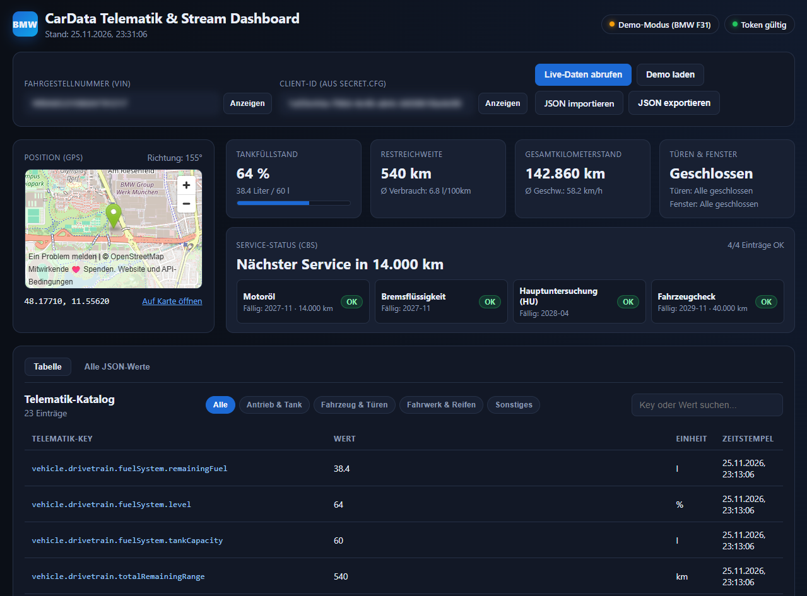

# BMW CarData Telematik Dashboard

Lokales Web-Dashboard und CLI-Tooling zum Abrufen und Visualisieren von Fahrzeugdaten über die offizielle **BMW CarData API** (ohne externe `npm`-Abhängigkeiten, lauffähig ab Node.js 18+).



---

## Funktionen

- **OAuth2 Device Code Flow mit PKCE:** Einmalige Browser-Anmeldung über BMW GCDM (`bmw-auth.js`), automatische Speicherung und Erneuerung per `refresh_token` in `bmw_tokens.json`.
- **Automatischer CarData-Container:** `bmw_show_api_data.js` ermittelt automatisch den aktiven CarData-Container (oder legt ihn bei Bedarf mit den benötigten Telematik-Keys an).
- **Dashboard (`http://127.0.0.1:3000`):**
  - **Position (GPS):** Eingebettete OpenStreetMap-Karte mit Fahrzeugmarker, Koordinaten, Fahrtrichtung und Direktlink.
  - **Tankfüllstand:** Anzeige in Prozent und Litern inkl. Fortschrittsbalken und Reserve-Warnung.
  - **Fahrzeugdaten:** Restreichweite, Gesamtkilometerstand, Türen & Fenster (`CLOSED`/`OPEN`), Service-Status (CBS inkl. Reststrecke bis zum nächsten Service).
  - **Telematik-Katalog:** Zwei Reiter für **Tabelle** (mit Suche und Kategoriefilter) sowie **Alle JSON-Werte** (vollständiger JSON-Payload mit Kopierfunktion).
  - **Live-Abruf mit Auto-Speicherung:** Jeder Live-Abruf speichert die JSON-Antwort automatisch mit Zeitstempel (`<VIN>_<YYYYMMDD_HH24MISS>.json`) im Projektordner.
  - **Demo & Import/Export:** Demo-Modus ohne API-Abruf, JSON-Import (inkl. automatischer VIN-Erkennung aus dem Dateinamen) und JSON-Export.
  - **Sichtschutz:** VIN und Client-ID sind in der Oberfläche standardmäßig per Blur verdeckt und lassen sich einzeln über **Anzeigen / Verbergen** einblenden.

---

## Voraussetzungen & Einrichtung

1. **Node.js 18+** (oder neuer) installieren.
2. Im BMW-Portal (*Mein Fahrzeug → BMW CarData → Technischer Zugang*) eine **Client-ID** anlegen und den Zugang zur CarData API aktivieren.
3. Im Projektordner die Datei `secret.cfg` anlegen bzw. prüfen:

```ini
CLIENT_ID=<deine-36-stellige-client-id>
VIN=<deine-17-stellige-fahrgestellnummer>
```

> **Hinweis:** `secret.cfg` und `bmw_tokens.json` sind in `.gitignore` eingetragen, damit Zugangsdaten und Tokens nicht versehentlich versioniert werden.

---

## Nutzung

### 1. Einmalig bei BMW anmelden
```powershell
npm run auth
```
Das Skript gibt eine BMW-URL (`https://customer.bmwgroup.com/oneid/link`) und einen Bestätigungscode aus. URL im Browser öffnen, mit dem MyBMW-Konto anmelden und den Code bestätigen. Danach wird `bmw_tokens.json` automatisch gespeichert.

### 2. Dashboard starten
```powershell
npm start
```
Anschließend im Browser öffnen: **http://127.0.0.1:3000**

- Über **Live-Daten abrufen** werden aktuelle Daten von der BMW CarData API geladen und als `<VIN>_<YYYYMMDD_HH24MISS>.json` gespeichert.
- Über **Demo laden** lassen sich Beispieldaten testen.

### 3. Telematikdaten direkt im Terminal abrufen (optional)
```powershell
npm run fetch
```

---

## Projektstruktur

| Datei | Beschreibung |
| --- | --- |
| `bmw-auth.js` | OAuth2 Device Code Flow (PKCE), Token-Speicherung und automatischer Refresh (`getValidToken`, `loadConfig`) |
| `bmw_show_api_data.js` | Container-Auflösung und Abruf von `/customers/vehicles/{vin}/telematicData` |
| `server.js` | Lokaler HTTP-Server auf `127.0.0.1:3000` (`/`, `/api/config`, `/api/demo`, `/api/telematic`) |
| `public/index.html` | Weboberfläche (Dashboard, OpenStreetMap-Einbettung, Telematik-Katalog) |
| `secret.cfg` | Lokale Konfiguration (`CLIENT_ID`, `VIN`) |
| `package.json` | ESM-Konfiguration (`"type": "module"`) und `npm`-Skripte |

---

## Hinweise zur BMW CarData API

- **Ereignisbasierte Aktualisierung:** BMW CarData aktualisiert Fahrzeugwerte ereignisbasiert (z. B. beim Abstellen/Verriegeln des Fahrzeugs) und nicht sekündlich während der Fahrt.
- **Einzelne Felder `null`:** Je nach Fahrzeugmodell und Ausstattung liefert nicht jeder Telematik-Key einen Wert (nicht verfügbare Felder werden in der Oberfläche automatisch ausgeblendet oder als `–` dargestellt).
